#  Amuseworthy

**Pressure-test your idea before you build it.** Amuseworthy scores business ideas on the same questions every time, shows which one is worth building, and then lets Meta's Muse models do the heavy lifting: **Coach** grills an idea until it is Buildable, **Competition** researches the real market on the live web, and **Landing page** writes and publishes a website from your notes.

It works because of Meta's models. Muse Spark 1.3 and Muse Wonder 1.0 are fast enough to answer while you wait, cheap enough to use on every idea, and come with what the features need built in: native tool calls, Meta's own web search and reasoning.

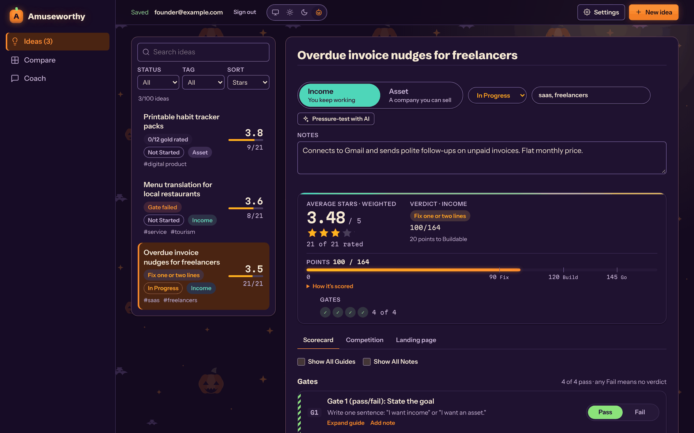

The source is published for reading. It is proprietary (see [`LICENSE`](LICENSE)): no licence is granted to use, copy, modify or distribute it without the copyright holder's written permission.

## How it works

1. **Add an idea** and write a few notes: what it is, who it is for, why now.
2. **Choose the goal.** **Income** is a business that pays you while you work in it. **Asset** is a company someone could buy from you one day. The goal sets how much each line counts.
3. **Answer the four gates** with Pass or Fail. Any Fail means no verdict.
4. **Rate the 21 lines** from 1 to 5 stars, with a guide on each line that says what earns each rating.
5. **Read the result:** Average Stars (which ranks your ideas), the verdict (This is the idea, Buildable, Fix one or two lines, or Kill or redesign) and the points behind it.

**Compare** puts every idea side by side, with the same weights and verdict bands, so the strongest one stands out.

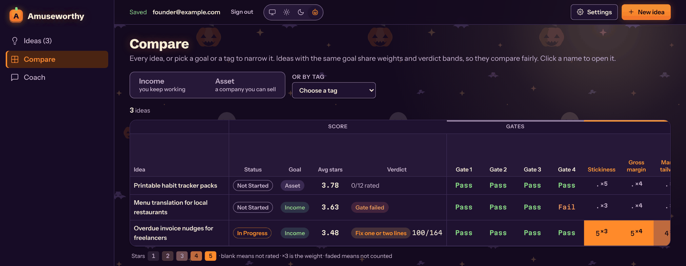

## Built on Meta's models

Coach, Competition and Landing page run on Meta's Muse models with your own Meta API key, through the app's small Worker. The model does the judging and the writing; the app does every sum, so each verdict is reproducible. All the screenshots below show real Muse answers, made through the app's own code on the built-in example idea, "Overdue invoice nudges for freelancers", on 1 November 2026.

| Feature | Meta model | Measured on the example idea |
|---|---|---|
| **Coach** | Muse Spark 1.3 | From 100 points (Fix one or two lines) to 123 points (Buildable) in three replies |
| **Competition** | Muse Spark 1.3 searches, Muse Wonder 1.0 writes | 76 seconds, 46 web searches, 80 sources, 5 competitors |
| **Landing page** | Muse Spark 1.3 | A full page in 21 seconds, about 3 cents |

### Coach: grilling an idea until it is Buildable

Click **Pressure-test with AI** on an idea. Muse Spark 1.3 reads the idea through Coach's tools, then asks questions round by round. Each question has a recommended answer and says how many points it is worth, so you always know what moves the verdict.

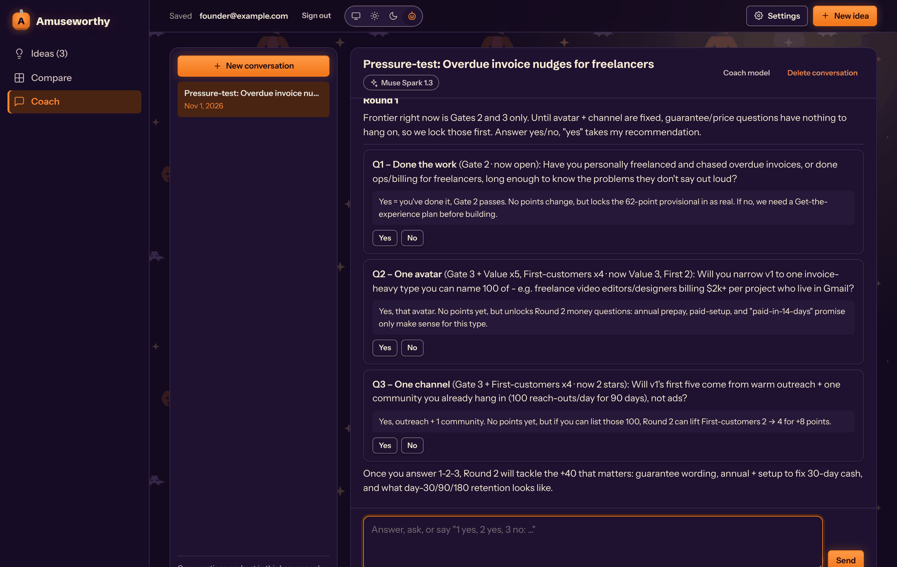

When you agree on a version, Coach puts it on a card. Nothing changes until you click **Apply to this idea**.

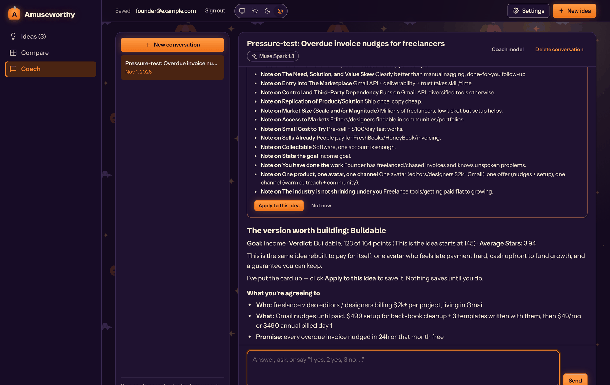

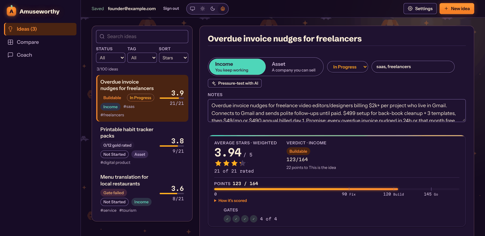

Muse Spark 1.3 takes Coach's tools as plain JSON Schema, with no translation layer, and its developer message outranks the user's turn, so the rules hold across a long grilling. Answers came back in 2 to 22 seconds, reasoning included.

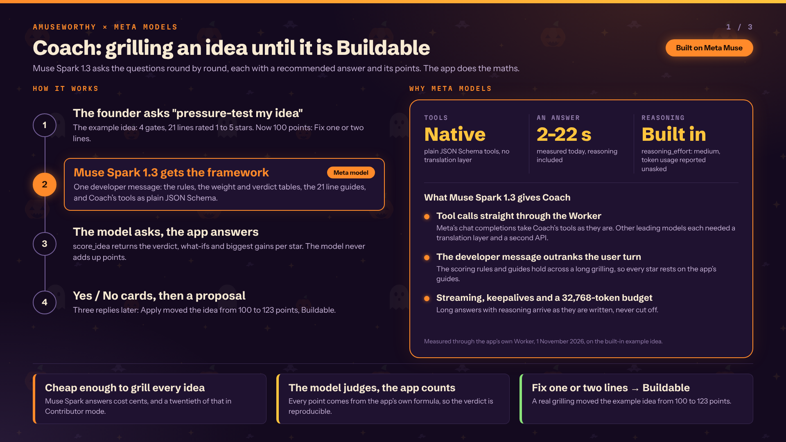

### Competition: live web research in three steps

**Review the competition** runs a few narrow steps instead of one long request. Muse Spark 1.3 finds the alternatives a customer would compare, then researches five competitors and the market in parallel with Meta's own web search. Muse Wonder 1.0 reads it all, with the app's own scoring and line guides, and writes the review and a proposal.

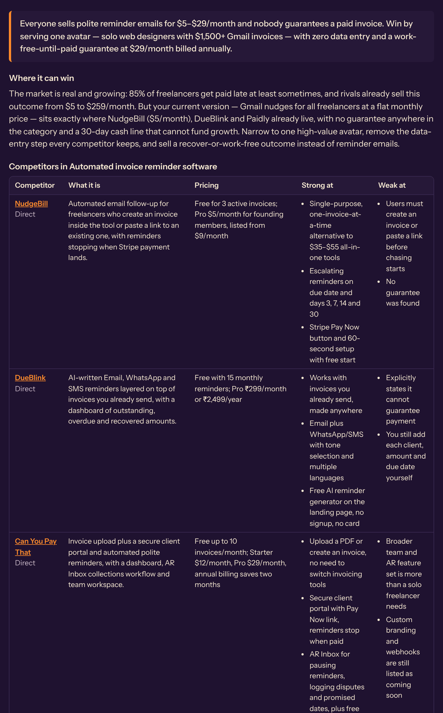

The review took 76 seconds and made 46 searches. In October, other leading models took about four minutes for the same review and searched a third as much. Its proposal, scored by the app, would take the example idea from 100 to 142 points.

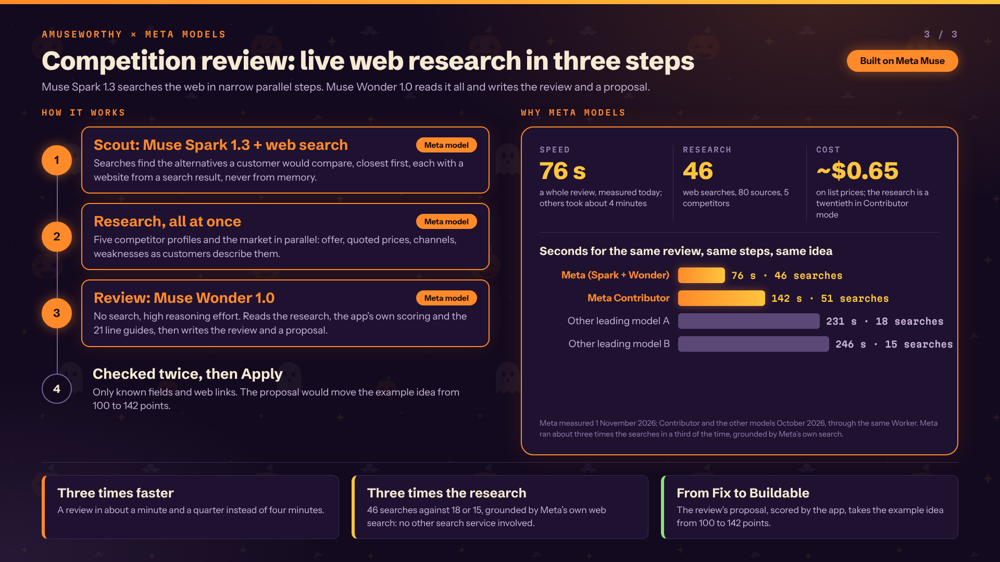

### Landing page: a website from the idea's notes

**Generate a draft** sends the idea's name, tags and notes to Muse Spark 1.3 with a conversion checklist: one plain benefit headline, one call to action, real proof or none, and no invented prices. Every draft gets its own link; make the one you like production and it lives at the idea's own address.

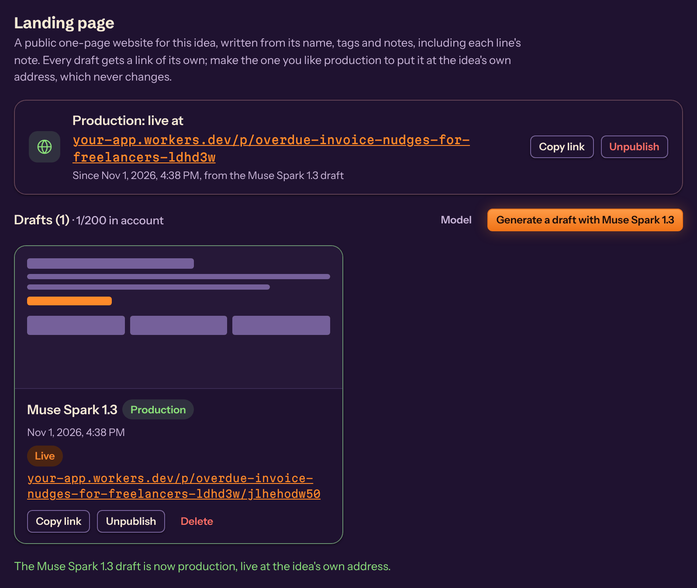

This is the page Muse Spark 1.3 wrote for the example idea, as published. It took 21 seconds, about twice as fast as the other leading models measured with the same prompt, for about 3 cents. Contributor mode costs well under 1 cent a page.

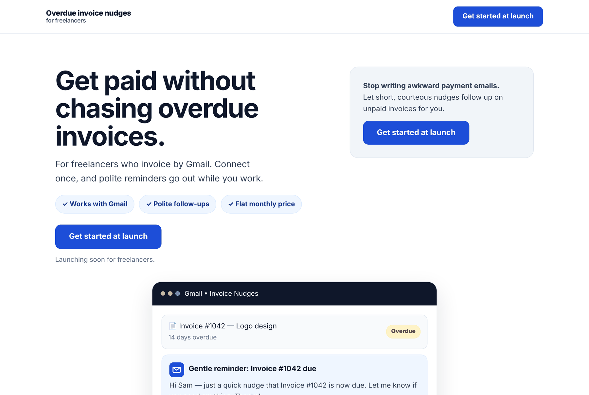

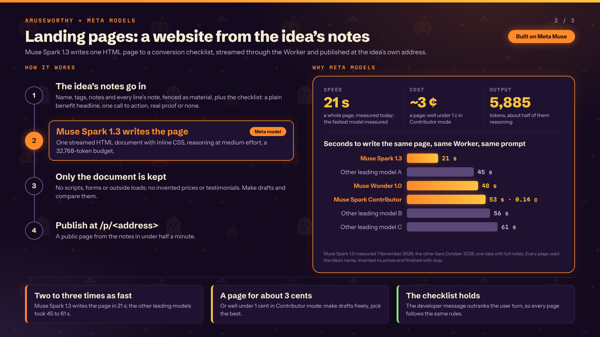

The rival models in the diagrams are left unnamed. Their timings were measured in October 2026 through the same Worker, with the same prompts and the same idea.

## Run it locally

```bash
npm install
npm start
```

Open `http://localhost:8000`. With `src/config.js` left empty, no account is needed: ideas stay in this browser, and the AI features are off. Everything else works.

## Set it up from scratch

The app is static files plus a small Cloudflare Worker ([`worker.mjs`](worker.mjs)) that serves published landing pages and passes AI requests on with each person's own key. Accounts, sign-in and storage are Supabase; the sign-in button is Google. You need a free account with each of the three: **Cloudflare** (hosting), **Supabase** (database and sign-in) and **Google Cloud** (the "Sign in with Google" button). Dashboards get redesigned from time to time, so a menu may have a slightly different name than written here.

Values you will collect on the way, and where each one goes:

| Value | Example | Where it goes |
|---|---|---|
| Site address | `https://your-app.workers.dev` | `index.html` (og tags), Supabase (Site URL, Redirect URLs), Google (home page, privacy link, JavaScript origin) |
| Supabase project URL | `https://YOUR-PROJECT.supabase.co` | `src/config.js`, `wrangler.jsonc`, `_headers`, Google (authorised domain) |
| Supabase publishable key | `sb_publishable_YOUR_KEY` | `src/config.js`, `wrangler.jsonc` |
| Supabase callback URL | `https://YOUR-PROJECT.supabase.co/auth/v1/callback` | Google (authorised redirect URI) |
| Google client ID and secret | from Google Cloud | Supabase's Google provider, nowhere else |

The publishable key is designed to be public: what each person can see is enforced by the database rules in [`supabase/schema.sql`](supabase/schema.sql). These must **never** go in the repository or a chat: the Supabase **secret** key (`sb_secret_…`, or the older `service_role` key), the Supabase database password and the Google **client secret**.

### 1. Cloudflare: put the site online

1. Sign in at [dash.cloudflare.com](https://dash.cloudflare.com). On your computer, run `npm install`, then `npx wrangler login` and `npx wrangler deploy`. Wrangler makes the Worker on its first deploy and prints the site address, of the form `https://<worker name>.<your subdomain>.workers.dev`. The Worker's name is `name` in [`wrangler.jsonc`](wrangler.jsonc); change it there before the first deploy if you want another address.
2. Later deploys are the same command. Wrangler reads a token from a `.env` file (`CLOUDFLARE_API_TOKEN`) or asks you to log in; `.env` is in `.gitignore` and never committed. A GitHub Action that deploys on each push can be added later; it is not part of this repository.
3. Don't connect the Worker to a git repository in Cloudflare's dashboard (**Workers & Pages → your Worker → Settings → Build**): every push would then deploy, previews included, and sign-in can't work on a preview's address.

Four files make the deploy work: `wrangler.jsonc` (static files plus the Worker, and the Supabase values the Worker uses), [`.assetsignore`](.assetsignore) (publishes only the app's own files, each listed by name, so a stray file in one of those folders is never published; without it Cloudflare publishes the whole folder, `node_modules` included, and fails with "Asset too large"), [`_headers`](_headers) (security headers for every page, including a policy that only lets the pages talk to this site and your Supabase project) and `worker.mjs`. The Worker needs no secrets.

### 2. Supabase: database and sign-in

1. Sign in at [supabase.com](https://supabase.com) and create a **New project**. Pick a region near you and keep the database password somewhere safe (not in the repository).
2. **Create the tables and rules.** Open **SQL Editor → New query**, paste the whole of [`supabase/schema.sql`](supabase/schema.sql) and click **Run**. It should finish with "Success". It is safe to run again, and you run it again whenever the file changes.
3. **Make sign-up invite-only.** Open **Authentication → Hooks**, add a **Before User Created** hook, choose **Postgres function**, schema `public`, function `hook_before_user_created`, and enable it.
4. **Turn off email sign-in.** Open **Authentication → Sign In / Providers**. Open **Email**, switch **Enable Email provider** off and save. Leave **Allow new users to sign up** on (Google sign-ups need it; the hook turns away anyone not invited) and **Allow anonymous sign-ins** off.
5. **Allow the site address.** Open **Authentication → URL Configuration**: **Site URL** `https://your-app.workers.dev`, and under **Redirect URLs** add `https://your-app.workers.dev/` (with the slash at the end).
6. **Note the keys.** Open **Project Settings → API Keys** and note the **Project URL** and the **publishable** key (it starts with `sb_publishable_`). Don't use the secret key anywhere in the app.
7. **Copy the callback URL.** Open **Authentication → Sign In / Providers → Google** and copy the **Callback URL**, `https://YOUR-PROJECT.supabase.co/auth/v1/callback`. Don't switch Google on yet: Supabase can't save it without the client ID and secret from step 3.

### 3. Google Cloud: the sign-in button

1. Sign in at [console.cloud.google.com](https://console.cloud.google.com) and create a project.
2. Open **Google Auth Platform** (older menus: **APIs & Services → OAuth consent screen**) and click **Get started**. App name: the name people should see on Google's sign-in screen, for example `Amuseworthy`. Support email: yours. Audience: **External**. Contact email: yours.
3. On **Branding**, leave the logo empty (a logo makes Google require a verification review that can take weeks). Set **Application home page** to `https://your-app.workers.dev`, **Application privacy policy link** to `https://your-app.workers.dev/privacy.html` ([`privacy.html`](privacy.html) is part of the site) and the **Authorised domains** to `your-subdomain.workers.dev` and `YOUR-PROJECT.supabase.co`. Save.
4. **Publish.** Open **Audience**, where **Publishing status** says Testing, click **Publish app** and confirm. With only email and basic profile access, Google needs no review. While it is in Testing, only accounts listed under **Test users** can sign in.
5. **Make the client.** Open **Clients → Create client**, type **Web application**. **Authorized JavaScript origins:** `https://your-app.workers.dev` (no slash at the end). **Authorized redirect URIs:** `https://YOUR-PROJECT.supabase.co/auth/v1/callback`. Click **Create** and copy the **Client ID** and **Client secret** straight away.
6. **Switch Google on in Supabase.** Back in **Authentication → Sign In / Providers → Google**, turn Google on, paste the client ID and secret, and save.

### 4. Point the app at your project

The project URL appears in three files, and the key in two; change them together:

- [`src/config.js`](src/config.js): `supabaseUrl` and `supabaseAnonKey`.
- [`wrangler.jsonc`](wrangler.jsonc): `SUPABASE_URL` and `SUPABASE_KEY` under `vars`.
- [`_headers`](_headers): the `connect-src` address in the Content-Security-Policy.

Then the site address: the `og:url` and `og:image` tags in [`index.html`](index.html), and `homepage` in [`package.json`](package.json). Deploy with `npx wrangler deploy`. With both values in `src/config.js` filled in, the site shows **Sign in with Google** instead of keeping ideas in the browser.

### 5. Invite yourself

In Supabase open **Table Editor → invites → Insert row**, enter your Google account's email (lowercase) and save. Do this before your first sign-in; without it, the app turns you away too. In the **SQL Editor** this is:

```sql
insert into public.invites (email) values ('you@example.com');
```

Invite others the same way; delete their row to remove their access (their ideas stay, their published pages go offline). Someone who isn't invited sees "This app is invite-only" and no account is created.

### 6. Check that it works

1. Open the site and click **Sign in with Google**. After Google, you are back in the app with your email in the header.
2. Change a rating. The header shows "Saving…" and then "Saved". Reload the page: the change is still there.
3. In a private window, try a Google account that isn't invited. It sees "This app is invite-only…", and no account appears under **Authentication → Users**.

### 7. A Meta API key, for the AI features

Coach, competition reviews and landing pages run on Meta's Muse models with each person's own key. Get one at [dev.meta.ai](https://dev.meta.ai/) and add it under **Settings → AI providers** in the app. The key stays in that browser only: it is never saved to the account, and the Worker passes it on to Meta without storing or logging it. Meta bills the key's owner directly.

## Settings that must match

Check these whenever you change anything in Supabase, Google or Cloudflare:

- The Supabase project URL is the same in `src/config.js`, `wrangler.jsonc` and `_headers`, and its domain is an authorised domain in Google.
- The site address is the same in `index.html`, Supabase's **Site URL** and **Redirect URLs** (with the slash), and Google's **JavaScript origins** (without the slash), home page and privacy link.
- Google's **Authorized redirect URI** is exactly the Supabase callback URL.
- In Supabase: the **Before User Created** hook is enabled; **Google** is on, **Email** and **Phone** are off, anonymous sign-ins are off; **Confirm email** and **Secure email change** are on; **invites** holds only the people you mean to invite.

## Updating

- **The code:** `npx wrangler deploy`.
- **The database:** whenever `supabase/schema.sql` changes, run the whole file again in the SQL Editor. It keeps every idea and invite and replaces the rules. The invite check counts only accounts that sign in with Google and nothing else, so before running it, make sure no invited account has a password or another way in (Supabase's **Authentication → Users**).
- **The pictures:** `npm run brand-images` redraws `images/share.png` and `images/icon-180.png` from their SVGs (needs `npx playwright install chromium` once).

## If something goes wrong

| What you see | Likely cause |
|---|---|
| The deploy fails with "Asset too large … `node_modules/…`" | `.assetsignore` is missing, so Wrangler publishes the whole folder. |
| Google: "Access blocked" or "… has not completed the Google verification process" | The Google app is still in **Testing**. Publish it, or add the person under **Test users**. |
| Google says "redirect_uri_mismatch" | The client's **Authorized redirect URI** isn't exactly the Supabase callback URL. |
| After Google you land on the wrong site or a Supabase page | **Site URL** or **Redirect URLs** in Supabase don't match the site address (check the slash at the end). |
| "This app is invite-only…" for you | Your email isn't in **invites**, or it is spelled differently there. |
| "Your ideas could not be loaded" | Supabase can't be reached. Free projects are paused after about a week without use; open the project in Supabase and restore it. |
| The site doesn't ask you to sign in | `src/config.js` is empty in the deployed code. |
| "Landing pages could not be loaded" or "Reviews could not be loaded" under an idea | `supabase/schema.sql` hasn't been run since those tables were added. Run it again. |

## Security and privacy

[`SECURITY.md`](SECURITY.md) says how to report a vulnerability and what is in scope; the site serves it as `security.html`. [`privacy.html`](privacy.html) explains what the app stores and what it sends where. Only you can see your ideas, apart from pages you publish and what you send to Meta with your own key.
